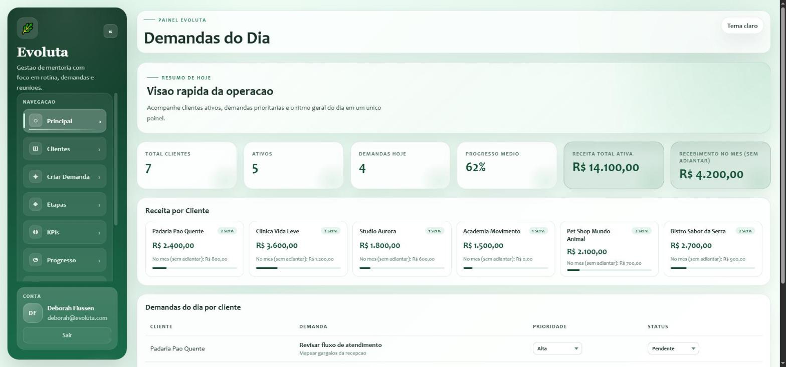
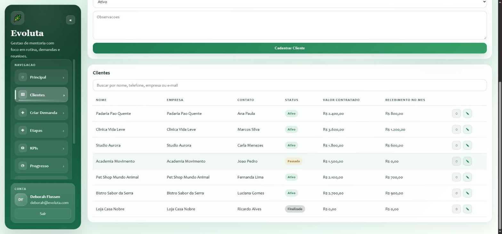

# Evoluta

Sistema para empresas de mentoria organizarem seus clientes e acompanharem as mentorias. Fiz o backend em Java com Spring Boot e o frontend em React.

*Telas com dados de demonstração.*

## O que pratiquei neste projeto

- Criar uma API REST com Spring Boot, separando controllers, DTOs e models
- Ligar o frontend em React ao backend (incluindo a configuração de CORS)
- Fazer login no sistema
- Salvar os dados num banco MariaDB

## Tecnologias

- Java 17
- Spring Boot (API REST)
- React + Vite
- MariaDB

## Funcionalidades

- Cadastro de clientes
- Controle das mentorias
- Login
- Frontend e backend conversando por API REST
- Dados salvos em banco relacional

## Pastas

- `backend/`: API com Spring Boot
- `frontend/`: telas em React
- `banco/`: scripts SQL

## Status

Em desenvolvimento.
